# Qublitz

Learn quantum engineering by playing. Qublitz is a set of interactive qubit labs, games, research tools and course
demos from the Fitzpatrick Lab at Dartmouth's Thayer School of Engineering. Everything runs in the browser, with
nothing to install.

### ▶ Open the demos: **[mvwf.github.io/qublitz](https://mvwf.github.io/qublitz/)**

[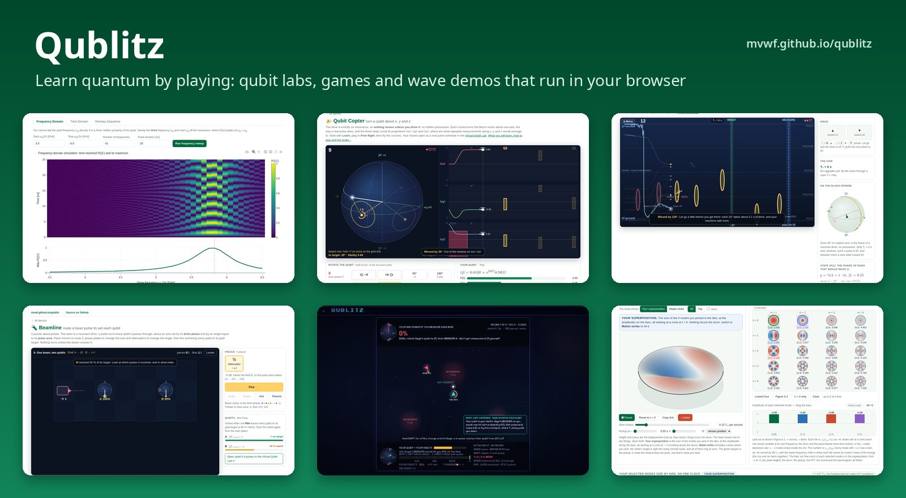](https://mvwf.github.io/qublitz/)

You can link straight to the site or to any page on it, for example the
[Virtual Qubit Lab](https://mvwf.github.io/qublitz/qublitz/qubit-simulator.html) or
[Rabi Rider](https://mvwf.github.io/qublitz/qublitz/rabi-rider.html). Pages embedded in another site (such as a
Google Site) show an "Open the full page ↗" button at the top.

**Real numbers from [Coherence Vault](https://mvwf.github.io/CoherenceVault/).** Qublitz is the teaching companion of Coherence Vault, the
NSF MARQUIS database of published superconducting-device data. The labs load real qubits, resonators and cryostat wiring
from it, 📚 lines across the site show the published spread behind a number (computed live from Coherence Vault's CSV files), and
Coherence Vault's tables open their rows straight into the matching Qublitz lab. See `web/shared/cvault.js`.

## Contents

- [Gallery](#gallery)
- [What's on the site](#whats-on-the-site)
- [Use it for teaching and outreach](#use-it-for-teaching-and-outreach)
- [Anonymous usage dashboard](#anonymous-usage-dashboard)
- [Develop](#develop)
- [Contact](#contact)
- [Funding](#funding)

## Gallery

Click a picture to open the page.

<table>
<tr>
<td width="33%" valign="top"><a href="https://mvwf.github.io/qublitz/qublitz/qubit-simulator.html">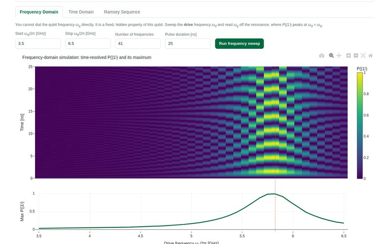</a><br><b>Qublitz Virtual Qubit Lab</b><br>Find a hidden qubit by experiment: frequency sweep, Rabi, T₁ and Ramsey.</td>
<td width="33%" valign="top"><a href="https://mvwf.github.io/qublitz/qublitz/qubit-copter.html">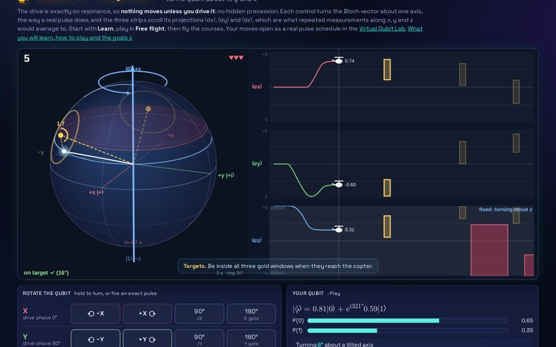</a><br><b>Qubit Copter</b><br>Turn a qubit about x, y and z yourself: nothing moves unless you drive it.</td>
<td width="33%" valign="top"><a href="https://mvwf.github.io/qublitz/qublitz/rabi-rider.html">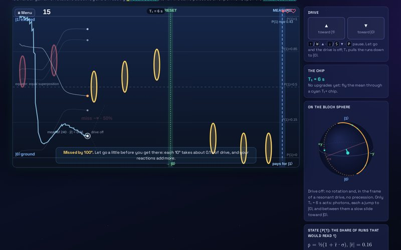</a><br><b>Rabi Rider</b><br>Drive an ensemble of runs through rings while T₁ decay knocks them back to |0⟩.</td>
</tr>
<tr>
<td valign="top"><a href="https://mvwf.github.io/qublitz/qublitz/beamline.html">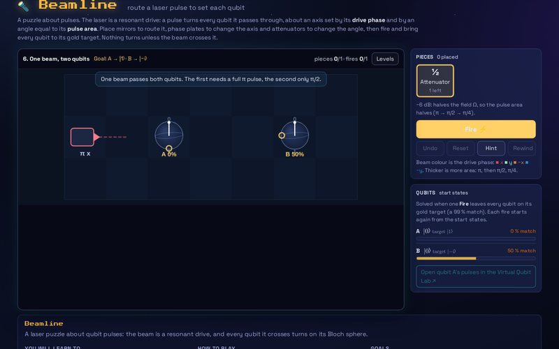</a><br><b>Beamline</b><br>A laser puzzle about pulse area and phase.</td>
<td valign="top"><a href="https://mvwf.github.io/qublitz/qublitz/arena.html">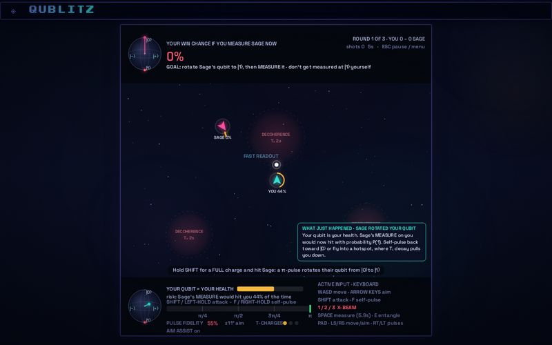</a><br><b>QuBlitz Arena</b><br>Photon Duel: rotate your opponent's qubit toward |1⟩ and measure when the odds are yours.</td>
<td valign="top"><a href="https://mvwf.github.io/qublitz/qublitz/fridge-noise.html">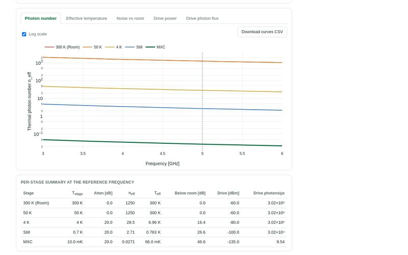</a><br><b>Fridge Noise Explorer</b><br>Follow room-temperature noise down a dilution fridge drive line.</td>
</tr>
<tr>
<td valign="top"><a href="https://mvwf.github.io/qublitz/qublitz/resonator.html">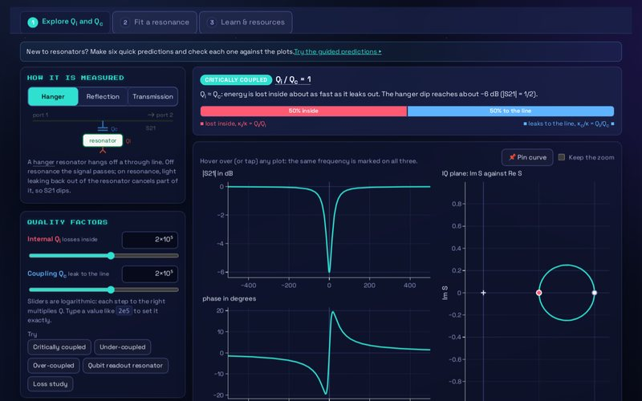</a><br><b>Resonator Lab</b><br>See how Qi and Qc shape a resonance, then fit a mystery resonator or your own VNA data.</td>
<td valign="top"><a href="https://mvwf.github.io/qublitz/qublitz/ep-tpd.html">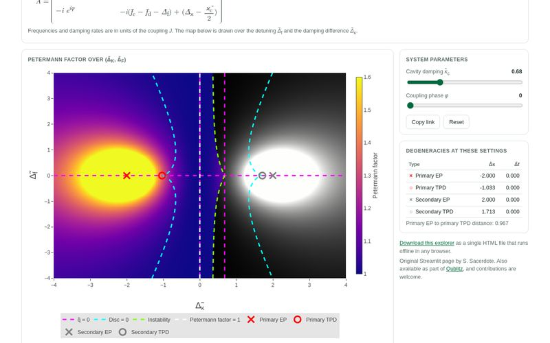</a><br><b>Exceptional Points &amp; TPDs</b><br>Map exceptional points and transmission-peak degeneracies in a magnon-photon dimer.</td>
<td valign="top"><a href="https://mvwf.github.io/qublitz/courses/engs23/heat-wave-schrodinger.html">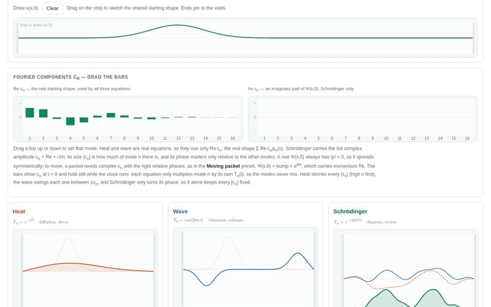</a><br><b>Three Equations, One Eigenbasis</b><br>Same shape, same modes: heat decays, a wave vibrates, Schrödinger disperses and revives.</td>
</tr>
<tr>
<td valign="top"><a href="https://mvwf.github.io/qublitz/courses/engs23/vibrating-string.html">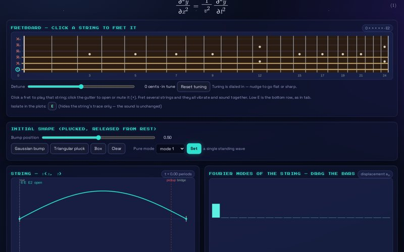</a><br><b>The Vibrating String</b><br>Pluck a string, read its Fourier modes and hear what the pickup hears.</td>
<td valign="top"><a href="https://mvwf.github.io/qublitz/courses/engs23/drum-head.html">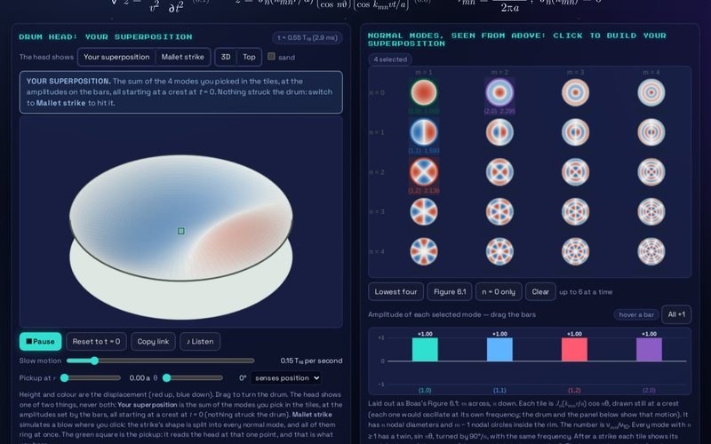</a><br><b>The Drum Head</b><br>Bessel normal modes of a circular membrane, and why a drum is less musical than a string.</td>
<td valign="top"><a href="https://mvwf.github.io/qublitz/courses/engs23/spectrogram.html">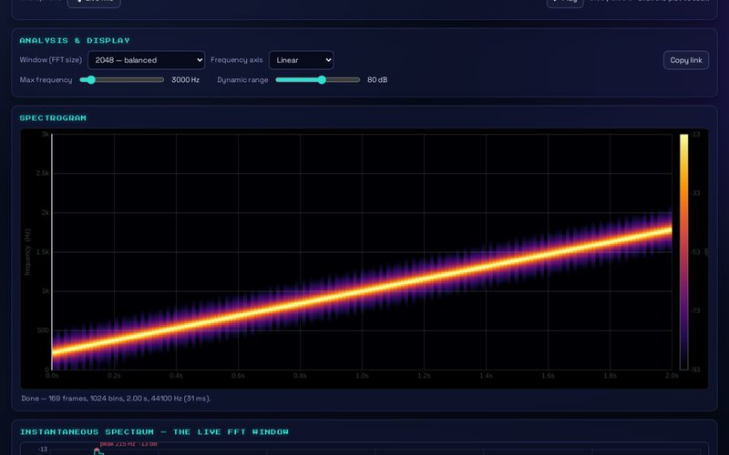</a><br><b>Spectrogram Explorer</b><br>A short-time Fourier transform of a recording or the live microphone.</td>
</tr>
<tr>
<td valign="top"><a href="https://mvwf.github.io/qublitz/qublitz/sonify.html">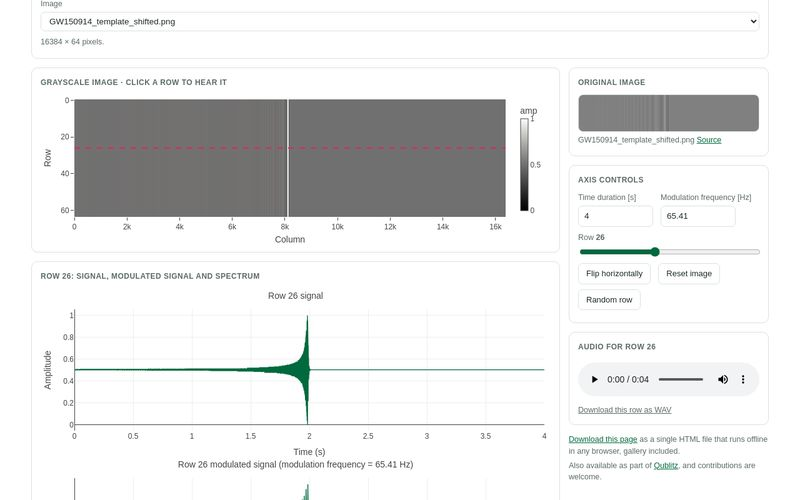</a><br><b>Sonify Images</b><br>Turn the rows of an image into sound.</td>
<td valign="top"><a href="https://mvwf.github.io/qublitz/">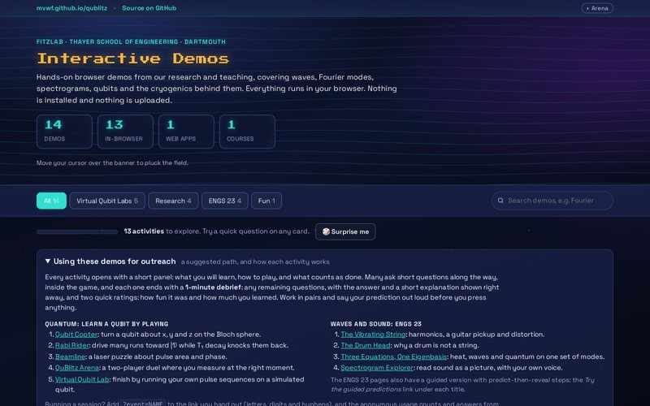</a><br><b>The hub</b><br>Every demo on one page, with search, filters and a suggested path for outreach.</td>
<td></td>
</tr>
</table>

## What's on the site

The hub groups the demos the same way as below.
Each card plays a live preview (hover to speed it up, drag to scrub it) and flips to a one-question teaser with **?
Question**. Cards you have opened get an **✓ Explored** badge, a bar counts how many you have tried, and **🎲 Surprise
me** opens one you have not seen yet. That progress stays in your browser.

Every page shares the QuBlitz Arena's retro look: pixel titles, neon on deep navy, and dark
charts. The **◐ theme menu** in the top bar (the same switch as Coherence Vault's) picks **Arena**, **Synthwave**, **Phosphor**
(green CRT), **Classic light** (the original look, good for projectors) or **Classic dark**. The choice is remembered
in your browser and shared with Coherence Vault; add `?theme=dark` (or another name) to a link to pick one.

### Virtual Qubit Labs: learn quantum by playing

Built on single-qubit Lindblad physics with T₁ relaxation, T₂ dephasing and real gates.

| Demo | What you do |
|---|---|
| [**Qublitz Virtual Qubit Lab**](https://mvwf.github.io/qublitz/qublitz/qubit-simulator.html) | Find a mystery qubit by experiment (frequency sweep, Rabi, T₁ and Ramsey), set your own qubit in free play, or, as an instructor, generate a code for every student with a private answer key. |
| [**Qubit Copter**](https://mvwf.github.io/qublitz/qublitz/qubit-copter.html) | Turn a qubit about x, y and z yourself: nothing precesses unless you drive it. Short lessons on what each rotation does, free flight with live P(1) and ⟨σ⟩ readouts, timed courses, and a link that replays your moves as pulses in the Virtual Qubit Lab. |
| [**Rabi Rider**](https://mvwf.github.io/qublitz/qublitz/rabi-rider.html) | Fly an ensemble of runs of one experiment with a single resonant drive: ▲ climbs toward \|1⟩, and each run falls back in its own quantum jump and shoots out a photon at a rate set by T₁. There is no precession: nothing turns unless you drive it. Collect T₁+ upgrades, dodge T₁− defects, and aim the mean through the rings to get the most runs to succeed. |
| [**Beamline**](https://mvwf.github.io/qublitz/qublitz/beamline.html) | Route a resonant drive with mirrors, change its axis with phase plates and its angle with attenuators, and bring every qubit to its target: flips, superpositions, a 2π return and turns that do not commute. Twelve levels with stars, hints and a sandbox. |
| [**ErrorSweeper**](https://mvwf.github.io/qublitz/qublitz/errorsweeper.html) | Quantum error correction as a deduction game: you never see the errors, only the stabilizer lamps around them. Fix them without creating a logical error on repetition, rotated surface (d = 3–7), toric, Steane and Shor codes; play rounds against a minimum-weight matching decoder; design your own CSS code in the code lab (it checks commutation and finds n, k, d); and run a live threshold experiment. |
| [**QuBlitz Arena**](https://mvwf.github.io/qublitz/qublitz/arena.html) | Photon Duel: pulse beams rotate your opponent's qubit toward \|1⟩, and you MEASURE when the odds are yours, before they measure you. A coach shows the best shot and the physics behind it. Entangle with a real CNOT and fight over whether your outcomes match. Seven training missions each teach one concept, from the Born rule to the Zeno effect. Keyboard, mouse or gamepad; laptop screen. |

### Research tools

Tools built in the lab to run quantum hardware, released openly for anyone to use.

| Demo | What you do |
|---|---|
| [**Fridge Noise Explorer**](https://mvwf.github.io/qublitz/qublitz/fridge-noise.html) | Follow room-temperature noise down a dilution fridge drive line. Set each stage's temperature and attenuation and see how many thermal photons reach the qubit. |
| [**Resonator Lab**](https://mvwf.github.io/qublitz/qublitz/resonator.html) | See how internal and coupling quality factors shape a resonance in magnitude, phase and the IQ plane, then fit one: a mystery resonator with a hidden answer, or your own VNA data (CSV or Touchstone) with built-in models or a formula you type. Exports a Python script. |
| [**Exceptional Points & TPDs**](https://mvwf.github.io/qublitz/qublitz/ep-tpd.html) | Map where exceptional points and transmission-peak degeneracies sit in a tunable magnon-photon dimer, and watch them separate as the coupling phase and damping change. |
| [**Cassini Fridge Monitor**](https://github.com/jussalcedoga/cassini_monitor_fitzlab) | Cryogenic monitoring for Bluefors dilution refrigerators, with live dashboards, real-time log tracking, pump and flow monitoring, and EM-environment estimates. A separate project, linked from the hub. |

### ENGS 23: Systems, Fields and Waves

Intuition helpers built on the course spine of separating variables into a spatial eigenproblem −φ″ = λφ, where
each equation turns the same modes into different behavior in time.

| Demo | What you do |
|---|---|
| [**Three Equations, One Eigenbasis**](https://mvwf.github.io/qublitz/courses/engs23/heat-wave-schrodinger.html) | Give heat, wave and Schrödinger the same starting shape and the same modes, then watch one decay, one vibrate, and one disperse and revive. |
| [**The Vibrating String**](https://mvwf.github.io/qublitz/courses/engs23/vibrating-string.html) | Pluck a string, read its Fourier modes, and hear a pickup sample it at one point. Raise the gain until clipping invents harmonics. |
| [**The Drum Head**](https://mvwf.github.io/qublitz/courses/engs23/drum-head.html) | The circular membrane of Boas ch. 13 §6. Watch Bessel normal modes oscillate side by side on one clock at their inharmonic frequencies, strike the head and see which modes ring, and hear why a drum is less musical than a string. |
| [**Spectrogram Explorer**](https://mvwf.github.io/qublitz/courses/engs23/spectrogram.html) | Drop in a recording or stream the microphone live. A short-time Fourier transform paints frequency against time. |
| [**The Hydrogen Atom**](https://mvwf.github.io/qublitz/courses/engs23/hydrogen.html) | Griffiths §4.2 made interactive: every state ψ<sub>nlm</sub> as a rotatable 3D electron cloud or surface, with its energy, lifetime and decay photons (lifetimes computed from dipole matrix elements and the free-space rate of spontaneous emission, checked against NIST). A laser spectroscopy lab finds the Lyman and Balmer lines and resolves a natural linewidth; a pulse lab builds π, π/2 and Ramsey sequences and sends them to the Virtual Qubit Lab; and H, D, T, He⁺ and Li²⁺ (or a mystery atom) can be compared. Sources cited on the page. |

The ENGS 23 pages also have a guided version: add `?guided=1` for predict-then-reveal checkpoints.

### Just for fun

| Demo | What you do |
|---|---|
| [**Sonify Images**](https://mvwf.github.io/qublitz/qublitz/sonify.html) | Turn the rows of an image into sound: brightness becomes amplitude on a carrier tone. Try the Mona Lisa, a gravitational-wave chirp or your own picture. |

## Use it for teaching and outreach

- **Everything runs in the browser.** There is nothing to install and no account to make. Send students a link to
  the hub or to one page.
- **A learning panel on every page** says what you will learn, how to play, and what counts as done.
- **Questions inside the games.** Many activities ask short questions along the way, inside the game.
- **A 1-minute debrief at the end** of every activity: any remaining questions, with the answer and a short
  explanation shown right away, and two quick ratings: how fun it was and how much you learned.
- **A suggested path** on the hub: Qubit Copter, Rabi Rider, Beamline and QuBlitz Arena, then finish by running your
  own pulse sequences in the Virtual Qubit Lab. Work in pairs and say your prediction out loud before you press
  anything.
- **Session links.** Add `?event=CODE` to a link you hand out (for example
  `https://mvwf.github.io/qublitz/?event=SCIFAIR26`), and the anonymous counts from that session are grouped together.
  Use letters, digits and hyphens, and neutral codes rather than names.
- **Offline downloads.** The Virtual Qubit Lab, Qubit Copter, Rabi Rider, Beamline, the Fridge Noise Explorer, the
  Resonator Lab, the EP/TPD explorer, Sonify and the four ENGS 23 demos each offer a single-file download that runs
  from disk in any browser with no network. The Spectrogram Explorer's archive.org recordings still need a
  connection; its bundled gong, uploads and microphone do not.
- **Instructor codes.** In the Virtual Qubit Lab an instructor can generate a qubit code for every student, with a
  private answer key.

<table>
<tr>
<td width="50%" valign="top">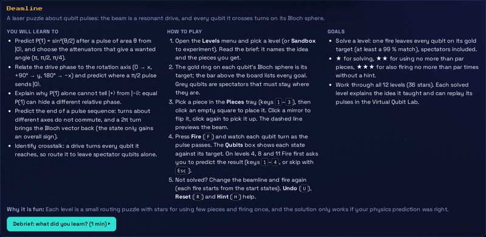<br>The learning panel at the top of each page.</td>
<td width="50%" valign="top">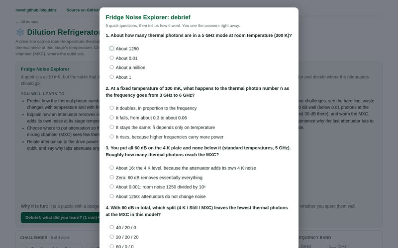<br>The 1-minute debrief.</td>
</tr>
</table>

## Anonymous usage dashboard

- Live: [mvwf.github.io/qublitz/outreach/dashboard.html](https://mvwf.github.io/qublitz/outreach/dashboard.html) · demo with synthetic data: [`…/dashboard.html?demo=1`](https://mvwf.github.io/qublitz/outreach/dashboard.html?demo=1)
- Shows aggregate, anonymous usage of the web demos, the debrief results, insights on what to fix, a report for proposals and redesign briefs per game. It is linked only from here, not from the site.
- Collected anonymously (no identifiers, no text, dates only). Set-up guide for the collector: [tools/outreach-collector/SETUP.md](tools/outreach-collector/SETUP.md).
- The data are an open, versioned record of how the games are played; to analyse them with an AI, see [AI-GUIDE.md](tools/outreach-collector/AI-GUIDE.md).
- What is collected and how to opt out: [the privacy page](https://mvwf.github.io/qublitz/privacy.html).

## Develop

The site is static HTML and JavaScript with no build step. A push to `main` that changes `web/` publishes it to GitHub Pages.

```
web/                         the site
  index.html                 the hub: the DEMOS and GROUPS lists, cards, filters, search
  qublitz/                   the qubit labs, games and research tools, with their engines (*-engine.js)
  courses/engs23/            the ENGS 23 demos
  learning/                  each page's learning panel, how to play, and questions
  shared/                    shared helpers, including outreach.js (panels, debriefs, anonymous counts)
                             and retro.js + retro-fonts.js (the site-wide Arena look and theme switch)
  outreach/                  the usage dashboard
  vendor/                    third-party libraries served with the site (Plotly)
pages/_assets/quantum_chess.html   QuBlitz Arena, vendored; copied to qublitz/arena.html at deploy time
tools/outreach-collector/    the Google Apps Script collector behind the dashboard
scripts/build_standalone.py  builds the single-file offline downloads
```

More detail, including shareable-link parameters and how to add a demo, is in [web/README.md](web/README.md).

**Run it locally**

```bash
python3 -m http.server -d web
# then open http://localhost:8000
```

The Arena card and the offline download links need the built site, since those files are made at deploy time.

**Run the tests** (Node.js; these also run in CI)

```bash
for t in web/qublitz/tests/*.test.js; do node "$t"; done
node web/courses/engs23/tests/drum-engine.test.js
node web/shared/tests/outreach.test.js
```

**Build an offline copy** of a page

```bash
python3 scripts/build_standalone.py web/qublitz/qubit-simulator.html qubit-simulator-offline.html
```

It inlines the page's local scripts and fails if anything is still loaded from the network.

**Contribute:** make a branch, and open a pull request against `main`.

## Contact

For help or advice, email:

- Mattias Fitzpatrick: mattias.w.fitzpatrick@dartmouth.edu
- Juan Sebastián Salcedo Gallo: juan.sebastian.salcedo-gallo.th@dartmouth.edu

## Funding

Qublitz is supported by the Unitary Foundation and by the U.S. National Science Foundation through an NSF CAREER award,
No. [2540460](https://www.nsf.gov/awardsearch/show-award/?AWD_ID=2540460) (CAREER: Characterization of Material Defects Using
Broadband Two-Level-System Spectroscopy), and the NSF MARQUIS Quantum Leap Challenge Institute (Manufacturable and Resilient
Superconducting Quantum Information Systems), award No. [2553633](https://www.nsf.gov/awardsearch/show-award/?AWD_ID=2553633).
Any opinions, findings, and conclusions or recommendations expressed in this material are those of the author(s) and do not
necessarily reflect the views of the National Science Foundation.
