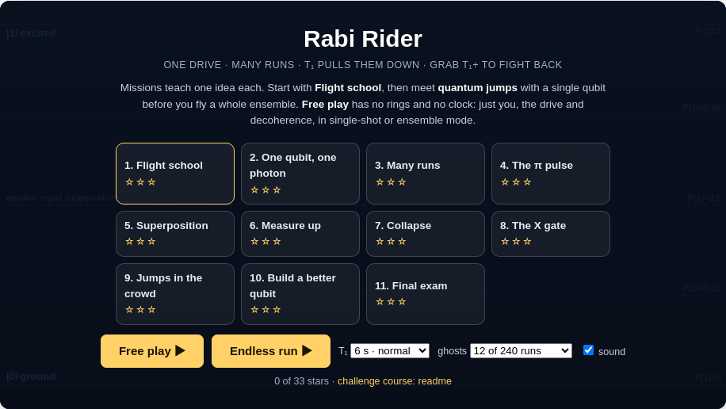
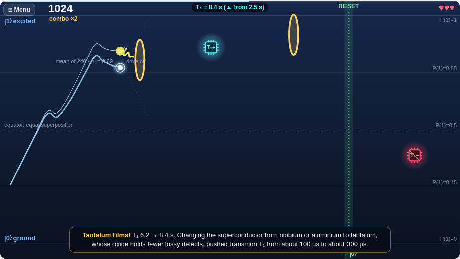
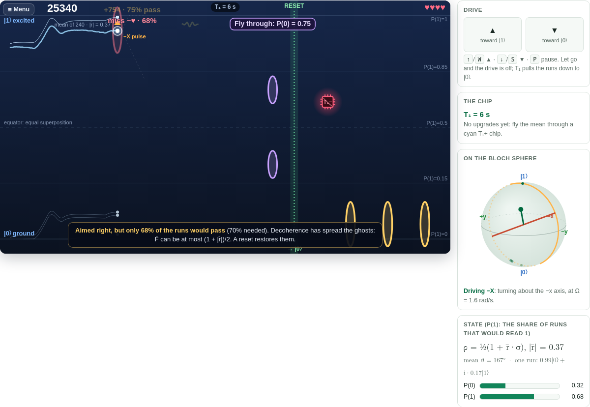

# QuBlitz Virtual Qubit Simulator

### ▶ Open the interactive demos: **[mvwf.github.io/qublitz](https://mvwf.github.io/qublitz/)**

Everything runs in the browser, with nothing to install. Link straight to the site, or to any demo on it, for
example [Qubit Simulator](https://mvwf.github.io/qublitz/qublitz/qubit-simulator.html) or
[Rabi Rider](https://mvwf.github.io/qublitz/qublitz/rabi-rider.html). Pages embedded in another site (such as a Google
Site) show an "Open the full page ↗" button at the top.

Welcome!
## Table of Contents
- [Overview](#overview)
- [Installation](#installation)
- [Usage](#usage)
- [Outreach usage dashboard](#outreach-usage-dashboard)
- [Contributing](#contributing)
- [Contact](#contact)

## Overview
Qublitz is a simulation tool aimed to lower the barrier to entry for students in high school and college trying to learn about Quantum Engineering. All simulations on Qublitz demonstrate the behavior of a single, two-level qubit that occupies states between 1 and 0. The engine behind every mode in Qublitz is `quantum_simulator.py`, which takes in given parameters to simulate the behavior of a single, two-level qubit.

Qublitz currently includes the following apps:

### 🌀 Rabi Rider
**[Play it in the browser](https://mvwf.github.io/qublitz/qublitz/rabi-rider.html)**: a game about driving a qubit and fighting T₁.
Your qubit's height is its polar angle θ on the Bloch sphere (|0⟩ at the bottom, |1⟩ at the top). Hold ▲ or ▼ to apply a resonant
drive and fly the state through rings, each a target state. There is no precession: nothing turns unless you drive it.



- **You fly an ensemble.** 240 runs of the same experiment share one drive. Each run emits its photon and drops to |0⟩ at its
  own random moment, and the faint ghosts show 12 of them. The big marker is their mean, the density matrix. A ring counts when the
  ensemble's fidelity with it, F̄ = (1 + r̄·t̂)/2 (the share of runs that would pass), is at least 70 %, so you play to the mean.
- **T₁ is the only decoherence**, modelled as real amplitude damping. Photons leave at the rate P(1)/T₁, and between photons a
  superposition slides slowly toward |0⟩. Averaged over the runs, P(1) decays as e^(−t/T₁) and the coherence as e^(−t/2T₁).
- **Power-ups and hazards.** Cyan **T₁+** chips lengthen T₁ by 35 % each. Each is a real fix labs use (Purcell filter, infrared
  and magnetic shielding, cleaner surfaces, tantalum films, packaging) and comes with a one-line fact. Red **T₁−** chips are real
  faults (a TLS defect, a light leak, a trapped vortex, a lossy seam) and shorten it again: dodge them.



- **Eleven missions**, each teaching one idea: the π pulse, superposition, the Born rule (quiz gates), measurement collapse, the X
  gate, quantum jumps in a crowd, and *Build a better qubit*. There is also an **endless run** with a shareable course seed, and
  **free play** to switch between a single shot and the ensemble, measure, reset, and turn T₁ up or down.



The physics lives in `web/qublitz/rabi-engine.js` and is checked by `node web/qublitz/tests/rabi-engine.test.js`.

### Home
The landing page with a welcome message and navigation to all available apps.

### Resonator Lab (web only)
An interactive page on internal and coupling quality factors of microwave resonators ([open it](https://mvwf.github.io/qublitz/qublitz/resonator.html)). Students move Qi and Qc and watch the resonance change in magnitude, phase and the IQ plane, then fit a resonance: a mystery resonator with a hidden answer, or their own network-analyzer data (CSV or Touchstone) with the hanger, reflection or transmission model or a formula they type. Every fit can be exported as a Python script.

### Sonify Images
This app allows you to turn images into sound by mapping image data to audio signals. Upload your own image or use a premade one, and explore the sonification process interactively.

### Qubit Simulator (Free Play)
The Qubit Simulator is a sandbox that grants users access to most parameters necessary to simulate any qubit behavior they want. There are two simulation modes: time domain and frequency domain. In the time domain, you can set qubit properties and send microwave square pulses to see how the qubit reacts on the Bloch sphere and in probability graphs. In the frequency domain, you can observe the responsiveness of a qubit to a range of different driving frequencies.

### Custom Qubit Query
This app allows users to select from predefined qubit parameters (e.g., for classroom or assignment use) and run simulations with those settings.

### IQ Mixing
This app demonstrates IQ mixing, a key concept in quantum control and signal processing, allowing users to explore how in-phase (I) and quadrature (Q) signals combine to drive a qubit.

### Exceptional Point and Transmission Peak Degeneracy Exploration
This app provides interactive tools to explore exceptional points and transmission peak degeneracy in quantum systems, with visualizations and parameter controls.

## Installation 

Use Python 3.10 or newer. The current PyArrow security release no longer supports Python 3.9.

```bash
python3 -m venv .venv
source .venv/bin/activate
python -m pip install -r requirements.txt
```

### Libraries
Qublitz is hosted as a Streamlit app. The relevant libraries for installation are as follows:
- `streamlit`
- `pandas`
- `numpy`
- `plotly`
- `Pillow`
- `soundfile`
- `qutip` (for the quantum simulator)
Each page will also need to import `run_quantum_simulation` from `quantum_simulator`.

## Usage
Find the current website here:
https://qublitz-qubit-lab.streamlit.app/
[](https://unitary.fund)

## Outreach usage dashboard

- Live: [mvwf.github.io/qublitz/outreach/dashboard.html](https://mvwf.github.io/qublitz/outreach/dashboard.html) · demo with synthetic data: [`…/dashboard.html?demo=1`](https://mvwf.github.io/qublitz/outreach/dashboard.html?demo=1)
- Shows aggregate, anonymous usage of the web demos, the debrief results, insights on what to fix, a report for proposals and redesign briefs per game. It is linked only from here, not from the site.
- Collected anonymously (no identifiers, no text, dates only). Set-up guide for the collector: [tools/outreach-collector/SETUP.md](tools/outreach-collector/SETUP.md).
- The data are an open, versioned record of how the games are played; to analyse them with an AI, see [AI-GUIDE.md](tools/outreach-collector/AI-GUIDE.md).

## Contributing 
### General Steps 
To start contributing, fork the repository and clone the fork so you can run your version of Qublitz locally. Then, create a new branch `git checkout -b feature-branch-name` name the branch based on the feature you are working on. Eg. `git checkout -b gates-challenge`. Once your changes are made, commit them and push to branch. Finally open the pull request. 
### Specific Projects 
For the Gates Challenge, you should take the existing `2_gates_challenge.py` page and modify it. You may rewrite all of the code if you like but the gates page contains starter code for displaying the Bloch Sphere and showing how X and Y-Gates work. 
For the Step Pulse Challenge, you should take the existing `3_gates_challenge.py` page and modify it.  You may rewrite all of the code if you like but the gates page contains starter code for displaying the Bloch Sphere and input for creating a Step Pulse. 

## Contact 
For help or advice email: 
neo.y.cai.25@dartmouth.edu 
mattias.w.fitzpatrick@dartmouth.edu
juan.sebastian.salcedo-gallo.th@dartmouth.edu
