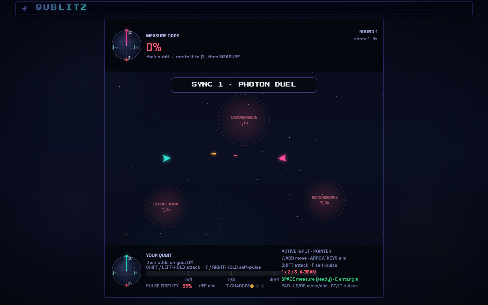

# Photon Duel replaces the board Arena

The existing QuBlitz Arena route now opens **Photon Duel** and **Duel Training** (seven missions). The former turn-based board game, army combat, local two-player board mode and Sage advisor are retired from the supported release. Historical versions remain available in Git history. The simulator pages are unchanged.

Move with WASD, aim with arrows or pointer, hold/release Shift to fire and F to self-pulse. Space measures; E entangles; 1/2/3 select beams; Escape pauses. The in-game hub documents pointer and standard-gamepad bindings. Click inside the embedded game for keyboard focus. Touch controls are not supported.

The static Pages build and Streamlit both use `pages/_assets/quantum_chess.html`. `VENDOR_SOURCE.md` records its canonical source and `VENDOR_SHA` pins its content. Run `bash scripts/verify.sh` before release. The vendor guard rejects missing or changed assets.

Fitted simulator T₁ drives the Physics Lab illustration only, not duel combat. Progress and records are stored locally in the browser. Physical controllers have not been certified; automated checks use virtual browser-standard pads. The Phase Rift composite-rotation test remains explicitly pending.

## Release verification — 2026-11-04

Canonical HTML source: `408ff2408b8d1e3e17af3565c144be78fff9f8b5`; SHA-256 `23baf04e2f6a320f160c7a16dce60816ceaceeda7f3c3ace0912479930f5f48b`. Screenshot below was captured from that unchanged HTML.

The fresh-upstream platform gate passes, including Python tests, lint, vendored physics and duel checks. All seven upstream JavaScript engine suites pass. The static site assembles, every local hub link resolves, and its Arena is byte-identical to the canonical source. Missing-manifest and modified-asset mutations both fail the vendor guard.

The real Streamlit iframe was also exercised: both mode launchers, focused keyboard movement, keyup with zero drift, and Escape pause passed without uncaught browser errors. The frame permits gamepad access; hardware remains untested.
